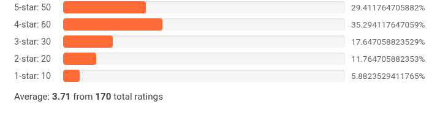

<p align="center">
  
</p>

# Sim-Rating - A Simple 5-Star Rating System for PHP

[](https://packagist.org/packages/emleons/sim-rating)
[](https://github.com/emleonstz/sim-rating/actions/workflows/tests.yml)
[](https://emleonstz.github.io/sim-rating/)
[](https://github.com/emleonstz/sim-rating/blob/main/LICENSE)

**Documentation:** <https://emleonstz.github.io/sim-rating/>

Sim-Rating is a lightweight,PHP library for displaying and calculating 5-star ratings. It supports multiple display formats (stars, bars, JSON) and is highly customizable and works with any php frame work.

<div align="center">

### Default Star Rating


---

### Custom Bar Rating  


</div>


## Features

- Works in any framework: Laravel, Symfony, CodeIgniter, or plain PHP
- Multiple output formats (HTML stars, HTML bars, standalone SVG, JSON)
- Customizable colors, sizes and styles (validated & escaped)
- Calculate averages, totals and distributions
- Secure by default — all rendered values are escaped (XSS-safe)
- Type-safe API with backed enums (`StarKey`, `DisplayType`)
- Accessible markup (`role="img"`, `aria-label`)
- Responsive and mobile-friendly
- Fully unit tested, statically analysed (PHPStan level 8) & style-checked (Pint)

## Installation

**Requirements:** PHP **8.3+**.

Install via Composer:

```bash
composer require emleons/sim-rating
```

### Basic Implementation
```php
require('vendor/autoload.php');
use Emleons\SimRating\Rating;

// Initialize with rating counts (all five keys recommended; missing keys default to 0)
$ratings = [
    'one_star' => 10,
    'two_star' => 20,
    'three_star' => 30,
    'four_star' => 40,
    'five_star' => 50
];

$rating = new Rating($ratings);

// Display 5-star rating
echo $rating->render(); // Defaults to HTML stars
```

### Output Formats
```php
// As interactive HTML stars
echo $rating->render('html', [
    'interactive' => true
]);

// As JSON data
$jsonOutput = $rating->render('json');
// {
//   "average": 3.67,
//   "total": 150,
//   "distribution": {
//     "five_star": 33.33,
//     "four_star": 26.67,
//     ...
//   }
// }

// As percentage bars
echo $rating->render('html', [
    'type' => 'bars',
    'bar_height' => '25px'
]);
```

### Customization Options
#### Star Display Options
```php
new Rating($ratings, [
    'type' => 'stars',       // Display type
    'color' => '#6a5acd',    // Star color
    'size' => '1.5rem',      // Size
    'show_average' => false, // Hide average
    'show_total' => true     // Show count
]);
```

#### Bar Display Options
```php
new Rating($ratings, [
    'type' => 'bars',
    'color' => '#4a90e2',          // Bar color
    'bar_height' => '20px',        // Bar thickness
    'bar_show_percentages' => true,// Show percentages
    'show_summary' => true         // Show summary
]);
```

### All Configuration Options

| Option | Type | Required | Default | Description |
|--------|------|----------|---------|-------------|
| `type` | string | Yes | `stars` | `stars` or `bars` |
| `color` | string | Yes | `#ffc107` | Main color |
| `size` | string | Yes | `1em` | Display size |
| `show_average` | bool | No | `true` | Show average rating |
| `show_total` | bool | No | `true` | Show total ratings |
| `show_summary` | bool | Yes | `false` | Show summary text |
| `interactive` | bool | Yes | `false` | Make ratings clickable |
| `bar_height` | string | No | `20px` | Bar thickness |
| `bar_spacing` | string | No | `8px` | Space between bars |
| `bar_show_percentages` | bool | No | `true` | Show percentages |

### Updating Options
```php
$rating->setOptions([
    'color' => '#e74c3c', // Change to red
    'size' => '2rem',     // Larger size
    'type' => 'bars'      // Switch to bars
]);

// Get current options
$currentOptions = $rating->getOptions();
```


#### Laravel Blade
```php
@php
    $rating = new \Emleons\SimRating\Rating($product->ratings, [
        'interactive' => true,
        'show_summary' => false
    ]);
@endphp

{!! $rating->render() !!}
```

### Important Tips
1. Rating keys are optional by default missing buckets count as `0`. Enable the `strict` option if you want to require all five.
2. Set `show_summary` based on your display needs
3. Use `interactive` only when you need user ratings
4. For bars, customize heights and spacing to match your design
5. All `color`/`size` values are validated and escaped automatically — invalid values safely fall back to defaults.

### Security
sim-rating escapes **every** value that ends up in the rendered markup, so it is safe to render data that originates from user input. Colour and size options are validated against strict allow-lists and fall back to safe defaults if they do not match.

```php
// Malicious option values are neutralised, never emitted verbatim.
$rating = new Rating(['five_star' => 1], [
    'color' => '"><script>alert(1)</script>', // falls back to #ffc107
]);

echo $rating->render(); // safe HTML
```

### Common Errors
```php
// Partial ratings are allowed by default (missing buckets = 0).
//    Enable 'strict' to require all five keys:
new Rating(['one_star' => 10], ['strict' => true]); // throws: Missing required rating key

// Unknown rating keys always throw
new Rating(['six_star' => 5]); // throws: Invalid rating key: six_star

// Invalid colour values are safely rejected and fall back to the default
new Rating($ratings, ['color' => 'red; } body { display:none']); // uses #ffc107

// Wrong option name (silently ignored)
new Rating($ratings, ['colour' => '#fff']); // Should be 'color'
```

## Styling

Every rendered element carries a stable, namespaced **BEM class** so you can
style it from your own CSS file. This is the recommended way to customize the
look it needs no raw-CSS option and carries **no injection risk**. The legacy
`sim-rating*` classes are still present (deprecated) for backward compatibility.

### Class map

| Element | BEM class | Legacy class (deprecated) |
|---------|-----------|---------------------------|
| Root (every widget) | `em-sim-rating` | `sim-rating` |
| Stars wrapper | `em-sim-rating__stars` | — |
| Each star | `em-sim-rating__star` | `sim-rating-star` |
| Average | `em-sim-rating__average` | `sim-rating-average` |
| Total | `em-sim-rating__total` | `sim-rating-total` |
| Bars root | `em-sim-rating__bars` | `sim-rating-bars-container` |
| A bar row | `em-sim-rating__bar` | `sim-rating-bar` |
| Bar label | `em-sim-rating__bar-label` | `sim-rating-bar-label` |
| Bar track | `em-sim-rating__bar-track` | `sim-rating-bar-bg` |
| Bar fill | `em-sim-rating__bar-fill` | `sim-rating-bar-fill` |
| Bar percent | `em-sim-rating__bar-percent` | `sim-rating-bar-percent` |
| Summary | `em-sim-rating__summary` | `sim-rating-summary` |
| SVG root | `em-sim-rating__svg` | `sim-rating-svg` |

### Option 1 — include the canonical stylesheet

Add the shipped stylesheet **once** in your layout, then render with inline
styles disabled:

```php
// Render without the per-instance <style> block.
echo (new Rating($data, ['type' => 'bars', 'inline_styles' => false]))->render();
```

```html
<link rel="stylesheet" href="/vendor/emleons/sim-rating/dist/sim-rating.css">
```

Theme it with CSS custom properties on `.em-sim-rating`:

```css
.em-sim-rating {
    --em-sim-rating-color: #e74c3c;
    --em-sim-rating-empty-color: #eee;
    --em-sim-rating-size: 1.5rem;
    --em-sim-rating-bar-height: 24px;
    --em-sim-rating-bar-radius: 999px;
}
```

…or write full rules against the BEM classes:

```css
.em-sim-rating__bar-fill { background: linear-gradient(90deg, #f39c12, #e74c3c); }
.em-sim-rating__star { transition: transform .15s; }
.em-sim-rating__star:hover { transform: scale(1.1); }
```

### Option 2 — target a single widget (uniqueness)

Give a widget a stable `instance_id`; it becomes a `data-sim-rating-id`
attribute and an `em-sim-rating--{id}` scope class:

```php
echo (new Rating($data, ['instance_id' => 'product-42', 'inline_styles' => false]))->render();
```

```css
.em-sim-rating[data-sim-rating-id="product-42"] { --em-sim-rating-color: #2ecc71; }
/* or */
.em-sim-rating--product-42 .em-sim-rating__bar-fill { background: #2ecc71; }
```

Each widget's default inline CSS is scoped to its own id, so multiple widgets on
one page never clash.

> **Note:** there is intentionally **no raw `custom_css` option**. Passing raw
> CSS through a value would re-introduce an injection vector. Style via the BEM
> classes / custom properties above instead.

## Display Types

### Stars
```php
echo $rating->render('html'); // Default star display
```

### Bars
```php
echo $rating->render('html', ['type' => 'bars']);
```

### SVG
```php
echo $rating->render('svg'); // A standalone <svg> element
```

### JSON Output
```php
echo $rating->render('json');
// {
//   "average": 3.67,
//   "total": 150,
//   "distribution": {
//     "one_star": 6.67,
//     "two_star": 13.33,
//     ...
//   }
// }
```

## Advanced Usage

### Type-safe display types
```php
use Emleons\SimRating\Enum\DisplayType;

echo $rating->render(DisplayType::Json);
```

### Per-render options (without mutating the instance)
```php
// A one-off colour change that does not affect future renders.
echo $rating->render('html', ['color' => '#e74c3c']);
```

### Strict validation
```php
// Throw unless all five buckets are provided.
$rating = new Rating($data, ['strict' => true]);
```

### Using in Frameworks

**Laravel:**
```php
// In controller
public function show(Product $product)
{
    return view('products.show', [
        'rating' => new \Emleons\SimRating\Rating($product->ratings)
    ]);
}

// In Blade
{!! $rating->render() !!}
```

**Symfony:**
```php
// In controller
public function show(Product $product): Response
{
    return $this->render('product/show.html.twig', [
        'rating' => new \Emleons\SimRating\Rating($product->getRatings())
    ]);
}

// In Twig
{{ rating.render()|raw }}
```

**CodeIgniter 4:**
```php
// In your Controller:
public function showProduct($productId)
{
    $productModel = new \App\Models\ProductModel();
    $product = $productModel->find($productId);
    
    $rating = new \Emleons\SimRating\Rating($product['ratings'], [
        'color' => '#f39c12', 
        'size' => '1.5rem'
    ]);
    
    return view('product_view', [
        'product' => $product,
        'ratingStars' => $rating->render('html')
    ]);
}

// In your View (PHP syntax):
<div class="product-rating">
    <?= $ratingStars ?>
    <small><?= number_format($rating->getAverage(), 1) ?> average (<?= $rating->getTotal() ?> ratings)</small>
</div>

// Or in Blade-style syntax if using CodeIgniter's View Decorator:
<div class="product-rating">
    {!! $ratingStars !!}
    <small>{{ number_format($rating->getAverage(), 1) }} average ({{ $rating->getTotal() }} ratings)</small>
</div>
```

## Documentation

Full guides live at **<https://emleonstz.github.io/sim-rating/>**.

Preview locally:

```bash
pip install -r requirements-docs.txt
mkdocs serve
```

Deploys automatically to GitHub Pages via [Docs workflow](.github/workflows/docs.yml)
on pushes to `main` touching `docs/**`, `mkdocs.yml`, or `requirements-docs.txt`.

## Testing

Run the full quality gate (code style + static analysis + tests):

```bash
composer check
```

Or run the pieces individually:

```bash
composer test          # PHPUnit
composer test:coverage # PHPUnit with a coverage report (needs pcov/xdebug)
composer lint          # Laravel Pint (dry-run)
composer analyse       # PHPStan (level 8)
```

## Contributing

Contributions are welcome! Please read [CONTRIBUTING.md](CONTRIBUTING.md) for
the local setup and quality bar, and [SECURITY.md](SECURITY.md) for how to
report security vulnerabilities.

## Changelog

See [CHANGELOG.md](CHANGELOG.md) for a history of notable changes.

## License

MIT License. See [LICENSE](LICENSE) for more information.